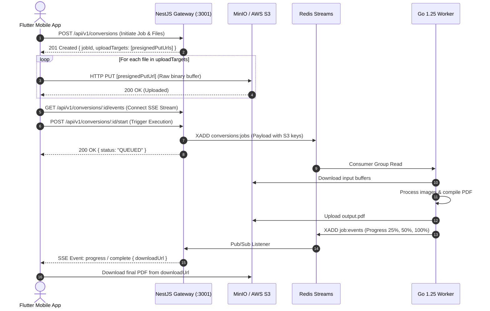

# 🔌 02. Backend API Specification & Wire Protocol

This document defines the complete communication protocol between the **KrocPDF Mobile App** and the **NestJS Backend API Gateway** (`backend-api`).

---

## 🌐 Base URL & Environments

| Environment | Base URL | Notes |
| :--- | :--- | :--- |
| **Local Android Emulator** | `http://10.0.2.2:3001` | Android loopback to host OS |
| **Local iOS Simulator** | `http://localhost:3001` | Direct localhost binding |
| **Local Physical Device** | `http://<YOUR_LAN_IP>:3001` | Ensure phone and computer are on same Wi-Fi |
| **Production Cloud** | `https://api.krocpdf.com` | Production TLS endpoint |

All endpoints reside under the `/api/v1/conversions` namespace.

---

## 🔄 End-to-End Cloud Conversion Sequence



---

## 📑 Endpoint Specifications

### 1. Initiate Conversion Job
Creates a database record, registers files, and generates direct S3 upload URLs.

- **Method**: `POST`
- **Route**: `/api/v1/conversions`
- **Headers**: `Content-Type: application/json`

#### Request Body
```json
{
  "jobType": "IMAGE_TO_PDF",
  "settings": {
    "pageSize": "A4",
    "orientation": "PORTRAIT",
    "margins": "SMALL",
    "dpi": 150,
    "transparencyMode": "flatten_white",
    "compressionLevel": "MEDIUM",
    "imageQuality": 90
  },
  "files": [
    {
      "fileName": "scan_page_1.jpg",
      "mimeType": "image/jpeg",
      "sizeBytes": 2097152
    },
    {
      "fileName": "scan_page_2.png",
      "mimeType": "image/png",
      "sizeBytes": 3145728
    }
  ]
}
```

#### Allowed Enums
- `jobType`: `IMAGE_TO_PDF` | `MERGE_PDF` | `COMPRESS_PDF` | `PDF_TO_JPG`
- `pageSize`: `A4` | `LETTER` | `LEGAL` | `FIT_TO_IMAGE`
- `orientation`: `PORTRAIT` | `LANDSCAPE` | `AUTO`
- `margins`: `NONE` | `SMALL` | `MEDIUM` | `LARGE`
- `transparencyMode`: `flatten_white` | `flatten_black` | `keep_transparent`
- `compressionLevel`: `LOW` | `MEDIUM` | `HIGH` | `MAXIMUM`

#### Response (`201 Created`)
```json
{
  "jobId": "f7d3a58e-1284-4b5c-a567-c102a1d29e44",
  "uploadTargets": [
    {
      "sequenceOrder": 0,
      "s3Key": "raw/f7d3a58e-1284-4b5c-a567-c102a1d29e44/0.jpg",
      "presignedPutUrl": "https://s3.amazonaws.com/krocpdf-conversions/raw/f7d3.../0.jpg?AWSAccessKeyId=..."
    },
    {
      "sequenceOrder": 1,
      "s3Key": "raw/f7d3a58e-1284-4b5c-a567-c102a1d29e44/1.png",
      "presignedPutUrl": "https://s3.amazonaws.com/krocpdf-conversions/raw/f7d3.../1.png?AWSAccessKeyId=..."
    }
  ]
}
```

---

### 2. Direct S3 Binary Upload
Upload raw file bytes directly to the presigned URL.

- **Method**: `PUT`
- **Route**: `[presignedPutUrl]` (Direct to S3/MinIO)
- **Headers**:
  - `Content-Type`: Exactly matches declared `mimeType` (`image/jpeg`, `image/png`, etc.)
- **Body**: Raw binary data stream (`Stream<List<int>>`)
- **Response**: `200 OK`

---

### 3. Start Conversion Execution
Signals the backend that all files are in S3 and execution can begin.

- **Method**: `POST`
- **Route**: `/api/v1/conversions/:jobId/start`
- **Response (`200 OK`)**:
```json
{
  "status": "QUEUED",
  "jobId": "f7d3a58e-1284-4b5c-a567-c102a1d29e44"
}
```
*Note: If any file from step 1 has not been uploaded, this returns `400 Bad Request`.*

---

### 4. Real-Time Server-Sent Events (SSE) Stream
Streams real-time progress, status updates, and the final download URL.

- **Method**: `GET`
- **Route**: `/api/v1/conversions/:jobId/events`
- **Headers**:
  - `Accept: text/event-stream`
  - `Cache-Control: no-cache`

#### Stream Message Format
```
event: progress
data: {"progress": 35, "status": "PROCESSING", "step": "Downsampling image 1 of 3"}

event: progress
data: {"progress": 85, "status": "PROCESSING", "step": "Compiling PDF document"}

event: complete
data: {"status": "COMPLETED", "downloadUrl": "https://s3.amazonaws.com/.../output.pdf?..."}
```

---

### 5. Cancel / Delete Job
Cancels a conversion and cleans up allocated resources.

- **Method**: `DELETE`
- **Route**: `/api/v1/conversions/:jobId`
- **Response**: `200 OK` `{ "success": true }`

---

## 📱 Flutter Implementation Snippet (`Dio` + SSE)

```dart
import 'dart:async';
import 'dart:convert';
import 'dart:io';
import 'package:dio/dio.dart';

class KrocApiClient {
  final Dio _dio = Dio(BaseOptions(baseUrl: 'https://api.krocpdf.com'));

  // 1. Initiate job & get presigned URLs
  Future<Map<String, dynamic>> initiateJob({
    required List<File> files,
    String pageSize = 'A4',
    String orientation = 'PORTRAIT',
  }) async {
    final payload = {
      'jobType': 'IMAGE_TO_PDF',
      'settings': {
        'pageSize': pageSize,
        'orientation': orientation,
        'margins': 'SMALL',
      },
      'files': files.map((f) => {
        'fileName': f.path.split('/').last,
        'mimeType': f.path.endsWith('.png') ? 'image/png' : 'image/jpeg',
        'sizeBytes': f.lengthSync(),
      }).toList(),
    };

    final response = await _dio.post('/api/v1/conversions', data: payload);
    return response.data;
  }

  // 2. Direct S3 Upload
  Future<void> uploadFileToS3(String presignedUrl, File file, String mimeType) async {
    final bytes = await file.readAsBytes();
    await _dio.put(
      presignedUrl,
      data: bytes,
      options: Options(headers: {'Content-Type': mimeType}),
    );
  }

  // 3. Listen to SSE Stream
  Stream<Map<String, dynamic>> subscribeToEvents(String jobId) async* {
    final response = await _dio.get<ResponseBody>(
      '/api/v1/conversions/$jobId/events',
      options: Options(
        responseType: ResponseType.stream,
        headers: {'Accept': 'text/event-stream'},
      ),
    );

    final stream = response.data!.stream
        .cast<List<int>>()
        .transform(utf8.decoder)
        .transform(const LineSplitter());

    await for (final line in stream) {
      if (line.startsWith('data:')) {
        final jsonStr = line.replaceFirst('data:', '').trim();
        if (jsonStr.isNotEmpty) {
          yield jsonDecode(jsonStr) as Map<String, dynamic>;
        }
      }
    }
  }
}
```
