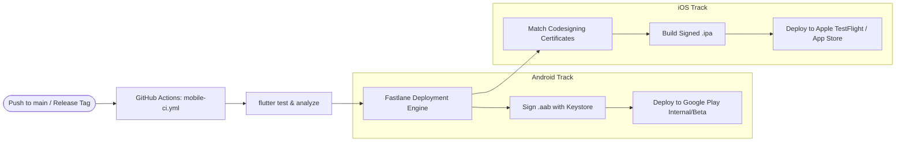

# 🚀 06. CI/CD & App Store Release Engineering

This document outlines the automated continuous integration and continuous delivery (CI/CD) pipelines for building, signing, and deploying **KrocPDF Mobile** to the **Apple App Store (TestFlight)** and **Google Play Console (Internal/Beta/Production tracks)**.

---

## 🏗️ Release Architecture Overview



---

## 🤖 GitHub Actions Workflow (`.github/workflows/mobile-ci.yml`)

Place this in the `krocpdf-mobile` repository:

```yaml
name: Mobile CI/CD - Build & Test

on:
  push:
    branches: [main]
    tags: ['v*']
  pull_request:
    branches: [main]

concurrency:
  group: ${{ github.workflow }}-${{ github.ref }}
  cancel-in-progress: true

jobs:
  lint-and-test:
    name: Flutter Lint & Unit Tests
    runs-on: ubuntu-latest
    steps:
      - name: Checkout repository
        uses: actions/checkout@v4

      - name: Setup Java 17
        uses: actions/setup-java@v4
        with:
          distribution: 'temurin'
          java-version: '17'

      - name: Setup Flutter SDK
        uses: subosito/flutter-action@v2
        with:
          flutter-version: '3.29.0'
          channel: 'stable'
          cache: true

      - name: Install dependencies
        run: flutter pub get

      - name: Verify Code Formatting
        run: dart format --output=none --set-exit-if-changed .

      - name: Analyze Static Analysis
        run: flutter analyze

      - name: Run Unit & Widget Tests
        run: flutter test --coverage

  build-android-bundle:
    name: Build Android App Bundle (.aab)
    needs: [lint-and-test]
    if: startsWith(github.ref, 'refs/tags/v')
    runs-on: ubuntu-latest
    steps:
      - uses: actions/checkout@v4

      - uses: actions/setup-java@v4
        with:
          distribution: 'temurin'
          java-version: '17'

      - uses: subosito/flutter-action@v2
        with:
          flutter-version: '3.29.0'
          cache: true

      - name: Decode Android Keystore
        env:
          KEYSTORE_BASE64: ${{ secrets.ANDROID_KEYSTORE_BASE64 }}
        run: |
          echo "$KEYSTORE_BASE64" | base64 --decode > android/app/upload-keystore.jks

      - name: Build Signed App Bundle
        env:
          KEYSTORE_PASSWORD: ${{ secrets.ANDROID_KEYSTORE_PASSWORD }}
          KEY_ALIAS: ${{ secrets.ANDROID_KEY_ALIAS }}
          KEY_PASSWORD: ${{ secrets.ANDROID_KEY_PASSWORD }}
        run: flutter build appbundle --release

      - name: Upload Artifact
        uses: actions/upload-artifact@v4
        with:
          name: app-release.aab
          path: build/app/outputs/bundle/release/app-release.aab
```

---

## 🏎️ Fastlane Configuration

### 1. Android (`android/fastlane/Fastfile`)
```ruby
default_platform(:android)

platform :android do
  desc "Deploy a new version to the Google Play Internal Track"
  lane :internal do
    gradle(
      task: "bundle",
      build_type: "Release"
    )
    upload_to_play_store(
      track: "internal",
      package_name: "com.krocpdf.app",
      json_key: "play-service-account.json"
    )
  end
end
```

### 2. iOS (`ios/fastlane/Fastfile`)
```ruby
default_platform(:ios)

platform :ios do
  desc "Push a new build to Apple TestFlight"
  lane :beta do
    match(type: "appstore", readonly: is_ci)
    build_app(
      workspace: "Runner.xcworkspace",
      scheme: "Runner",
      export_method: "app-store"
    )
    upload_to_testflight(
      api_key_path: "app_store_connect_api_key.json"
    )
  end
end
```

---

## 🔑 Required Repository Secrets

Configure these under **Settings > Secrets and variables > Actions** in the `krocpdf-mobile` repository:

| Secret Name | Description |
| :--- | :--- |
| `ANDROID_KEYSTORE_BASE64` | Base64-encoded `upload-keystore.jks` binary |
| `ANDROID_KEYSTORE_PASSWORD` | Master password for the Android release keystore |
| `ANDROID_KEY_ALIAS` | Key alias (e.g. `krocpdf-release`) |
| `ANDROID_KEY_PASSWORD` | Password for the signing key alias |
| `PLAY_STORE_JSON_KEY` | Google Play Console Service Account JSON credentials |
| `APP_STORE_CONNECT_API_KEY` | Apple App Store Connect API Key (`.p8`) for Fastlane authentication |
| `MATCH_PASSWORD` | Passphrase used to encrypt the iOS certificate repository |
