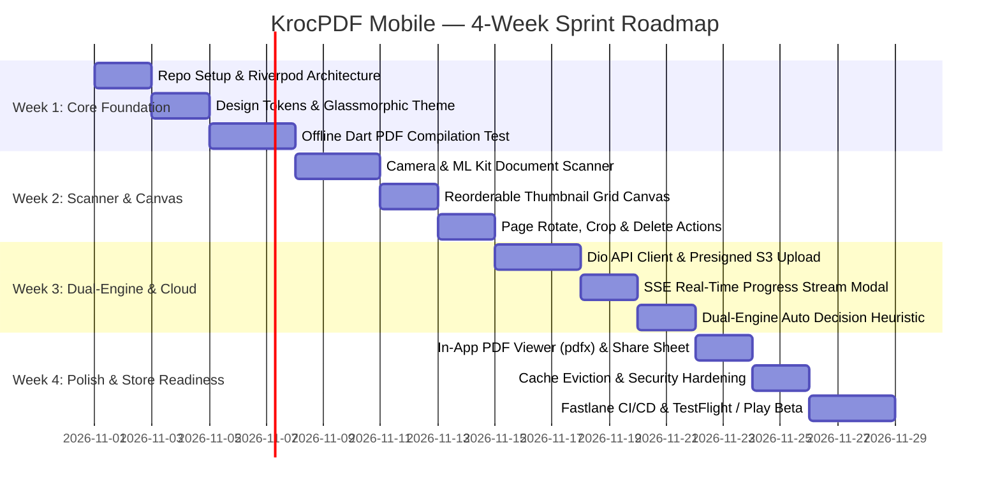

# 🧭 07. Intern 4-Week Sprint & Onboarding Roadmap

Welcome to the team! This document outlines your structured 4-week engineering roadmap to build, polish, and deploy the **KrocPDF Mobile App** (`krocpdf-mobile`).

Each week is organized into clear milestones, daily task breakdowns, and verifiable **Definitions of Done (DoD)**.

---

## 🗓️ 4-Week Milestone Timeline

---

## 📅 Week-by-Week Breakdown

### 📍 Week 1: Project Scaffold, Design Tokens & Local Compilation
**Goal**: Lay down the Clean Architecture foundation and prove native on-device PDF compilation.

- [ ] **Day 1**: Initialize `krocpdf-mobile` repository using Flutter 3.29+. Set up `analysis_options.yaml` and `flutter_lints`.
- [ ] **Day 2**: Implement design tokens in `app_colors.dart` and construct the reusable `GlassCard` and gradient button widgets.
- [ ] **Day 3**: Build Home Dashboard (`/home`) with static navigation cards for Scanner, Images-to-PDF, Merge, and Compress.
- [ ] **Day 4–5**: Implement local on-device compilation test: pick 3 sample JPEG files from gallery (`file_picker`), compile into a basic A4 PDF using the `pdf` package, and save to local app storage.
- **✅ Definition of Done (Week 1)**: User can tap "Images to PDF", select multiple photos from device, compile a valid PDF locally without internet, and view the file size.

---

### 📍 Week 2: Native Scanner & Interactive Reorder Canvas
**Goal**: Implement high-speed document scanning and smooth drag-and-drop page sequencing.

- [ ] **Day 6–7**: Integrate `google_mlkit_document_scanner` or `camera` controller. Implement edge detection preview and multi-page capture loop.
- [ ] **Day 8**: Build the Reorder Canvas (`/reorder`) using `ReorderableGridView`. Display captured pages as numbered cards with thumbnail previews.
- [ ] **Day 9**: Add card micro-actions: Rotate 90° clockwise, delete page, and insert additional pages.
- [ ] **Day 10**: Wire page geometry settings drawer (A4, Letter, Fit to Image; Portrait, Landscape; Margins).
- **✅ Definition of Done (Week 2)**: User can scan physical documents with automatic perspective correction, reorder pages via drag-and-drop, rotate misaligned pages, and produce a perfectly ordered local PDF.

---

### 📍 Week 3: Cloud Supercharger & Dual-Engine Integration
**Goal**: Wire the mobile app to KrocPDF's NestJS Gateway and Go worker cluster.

- [ ] **Day 11–12**: Build `KrocApiClient` with `dio`. Implement `POST /api/v1/conversions` to register files and retrieve presigned upload URLs.
- [ ] **Day 13**: Implement parallel S3 binary upload (`PUT`) with upload progress indicators.
- [ ] **Day 14**: Implement SSE stream consumer (`/api/v1/conversions/:id/events`) and display live percentage progress (`0% -> 100%`) in a sleek bottom sheet.
- [ ] **Day 15**: Implement `EngineDecisionHeuristic` to automatically choose between local on-device and cloud conversion based on batch size and network state.
- **✅ Definition of Done (Week 3)**: Large batches (>30 files) automatically upload to MinIO/S3, trigger Go conversion, stream real-time progress via SSE, and download the finished PDF.

---

### 📍 Week 4: Viewer, Sharing, Hardening & Store Deployment
**Goal**: Complete user export workflows, enforce privacy rules, and prepare store builds.

- [ ] **Day 16**: Implement In-App PDF Viewer using `pdfx` with pinch-to-zoom, page counter, and night mode.
- [ ] **Day 17**: Integrate `share_plus` to trigger native iOS AirDrop / Android Share Sheet and "Save to Files".
- [ ] **Day 18**: Implement `SecureDocumentCleaner` to wipe temporary scanned camera images upon export.
- [ ] **Day 19**: Configure `ios/Runner/Info.plist` and `android/app/src/main/AndroidManifest.xml` permissions.
- [ ] **Day 20**: Set up Fastlane lanes (`fastlane beta` for iOS TestFlight and `fastlane internal` for Google Play Track) and configure `.github/workflows/mobile-ci.yml`.
- **✅ Definition of Done (Week 4)**: A signed production build can be generated via GitHub Actions, tested on physical iOS and Android devices, and shared via TestFlight / Google Play Internal Track.

---

## 💡 Best Practices & Developer Tips

1. **Test on Physical Hardware**: Camera document scanning and haptic feedback behave differently on simulators than real phones. Keep a real device plugged in.
2. **Never Commit Secrets**: Do not check keystore passwords, `.jks` files, or App Store Connect `.p8` keys into git. Use GitHub Actions repository secrets.
3. **Keep Branches Small**: Open descriptive pull requests following Conventional Commits (e.g. `feat(scanner): implement mlkit edge detection`, `fix(reorder): prevent index out of bounds`).
4. **Questions or Blockers**: Reach out to the lead maintainers in our team Discord or post in repository GitHub Discussions.
